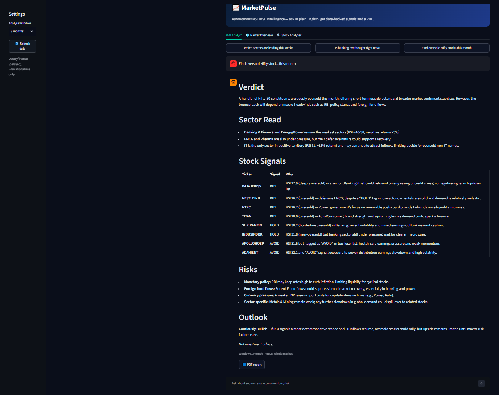
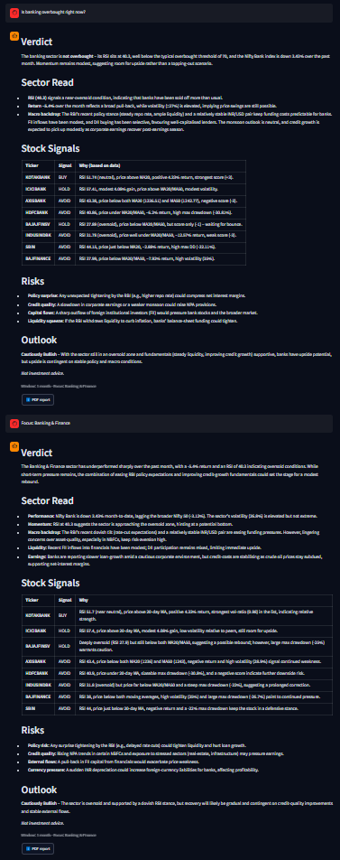
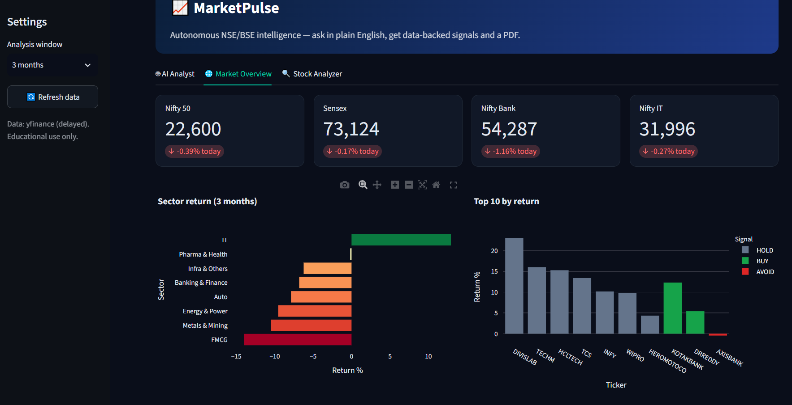
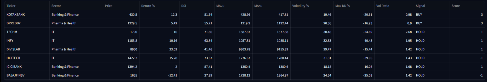
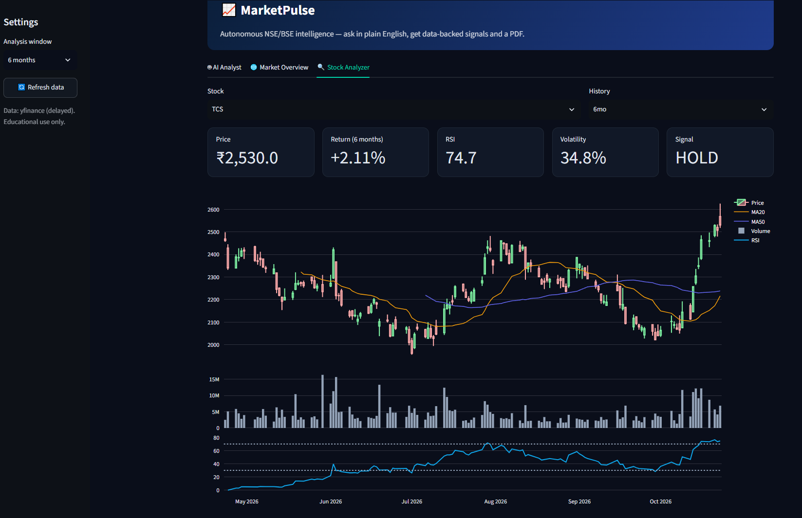

# 📈 MarketPulse

**Ask a question about the Indian market in plain English. Get live data, technical signals, AI commentary and a PDF report.**




## Overview

MarketPulse fetches live price data for the Nifty 50, computes technical indicators, assigns rule-based BUY / HOLD / AVOID signals, and asks an LLM to explain the results in the context of the Indian market (RBI policy, FII/DII flows, INR, crude). Everything can be exported as a formatted PDF.

Signals are computed from explicit rules, not generated by the LLM. The LLM only interprets the numbers it is given.

## Features

| Area | What it does |
|---|---|
| **AI Analyst** | Understands the time window ("this week", "this quarter") and sector ("is banking overbought?") from your question |
| **Technical engine** | Wilder RSI(14), MA20, MA50, annualised volatility, max drawdown, volume ratio, period return |
| **Signals** | Transparent scoring model (see below) |
| **Market Overview** | Nifty 50, Sensex, Nifty Bank, Nifty IT, sector performance, top 10 stocks, full signal board |
| **Stock Analyzer** | Candlestick with MA20/MA50, volume and RSI panels |
| **PDF report** | Indices, sector chart, top and bottom performers, AI commentary |
| **Reliability** | Chunked downloads with timeouts and retries, 15-minute cache, automatic Groq model selection |

## Screenshots

| Banking deep dive | Sector performance |
|---|---|
|  |  |
| **Signal board** | **Candlestick + RSI** |
|  |  |

A sample report is available at [`data/sample_report.pdf`](data/sample_report.pdf).

## How it works

```
Plain-English query
      │
      ▼
Intent parser ──► time window + sector focus
      │
      ▼
yfinance (NSE) ──► indicators ──► rule-based signals
      │
      ▼
Groq LLM ──► commentary (Verdict · Sector Read · Signals · Risks · Outlook)
      │
      ▼
Streamlit UI  +  PDF export (ReportLab)
```

### Signal model

Each stock gets a score from the rules below. A total of +2 or more is BUY, −2 or less is AVOID, and anything in between is HOLD.

| Rule | Points |
|---|---|
| RSI < 30 (oversold) | +2 |
| RSI > 70 (overbought) | −2 |
| Price above / below MA20 | +1 / −1 |
| MA20 above / below MA50 | +1 / −1 |
| Positive / negative return over the window | +1 / −1 |

### Time windows

| Phrase in query | Trading days |
|---|---|
| week | 5 |
| month (default) | 21 |
| quarter / 3 months | 63 |
| 6 months | 126 |
| year | 250 |

## Tech stack

Streamlit · Groq (Llama / GPT-OSS, auto-selected) · yfinance · Pandas · NumPy · Plotly · ReportLab

## Getting started

**Requirements:** Python 3.10+ and a free [Groq API key](https://console.groq.com).

```bash
git clone https://github.com/aryzus/marketpulse.git
cd marketpulse

python -m venv .venv
.venv\Scripts\activate          # Windows
# source .venv/bin/activate     # macOS / Linux

pip install -r requirements.txt

cp .env.example .env            # Windows: copy .env.example .env
# edit .env and add your GROQ_API_KEY

python -m streamlit run app.py
```

The first load takes about 30 to 60 seconds while market data downloads. After that it is cached for 15 minutes.

**Configuration (`.env`)**

| Variable | Required | Description |
|---|---|---|
| `GROQ_API_KEY` | Yes, for AI commentary | Without it, the data tabs still work |
| `GROQ_MODEL` | No | Force a specific model. By default the app picks one your key can access |

## Project structure

```
marketpulse/
├── app.py              # Streamlit UI (3 tabs)
├── agent.py            # Intent parsing, LLM prompt, model selection
├── analysis.py         # Data fetching, indicators, signals
├── report.py           # PDF generation
├── stocks.py           # Nifty 50 tickers and sector map
├── data/               # Sample report
├── screenshots/
├── .streamlit/config.toml
├── requirements.txt
└── .env.example
```

## Troubleshooting

| Problem | Fix |
|---|---|
| Stuck on "Fetching live NSE data…" | `pip install -U yfinance`, then check VPN or proxy and rerun |
| Index card shows "n/a" | Yahoo occasionally fails for index symbols. Press **Refresh data** |
| "LLM call failed" or model not found | Set `GROQ_MODEL` in `.env`, or check your key at console.groq.com |
| Some stocks are missing | Delisted or renamed tickers are skipped. Update `stocks.py` |

## Limitations

- Data comes from Yahoo Finance through yfinance. It is delayed and unofficial.
- The Nifty 50 list in `stocks.py` is static and must be updated when the index changes.
- The AI commentary can include general market context that is not in the supplied data. Check it against the numbers.
- Signals are simple technical rules, not a validated trading strategy.

## Roadmap

- [ ] Backtesting of the signal model
- [ ] Watchlist and alerts
- [ ] News sentiment layer
- [ ] Scheduled daily reports

## Disclaimer

MarketPulse is for educational purposes only and is not investment advice. Do your own research before making financial decisions.

## License

MIT