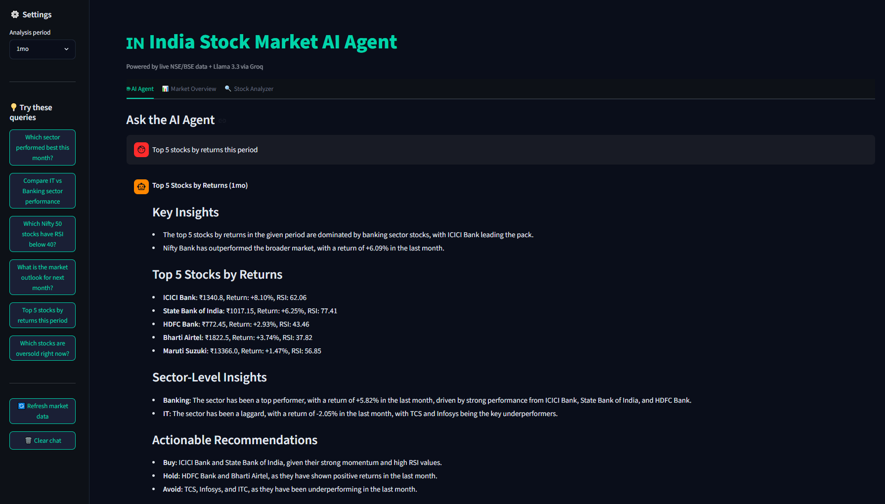
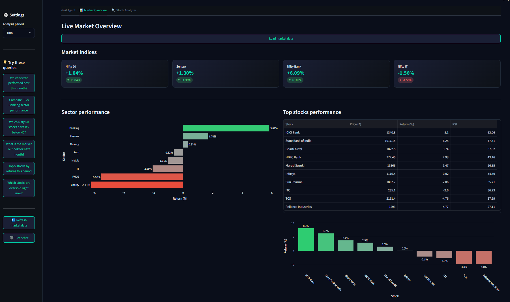
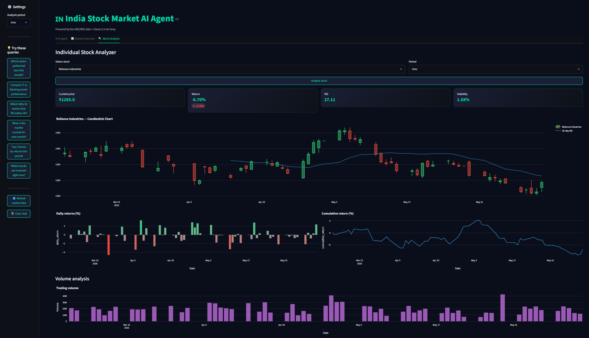
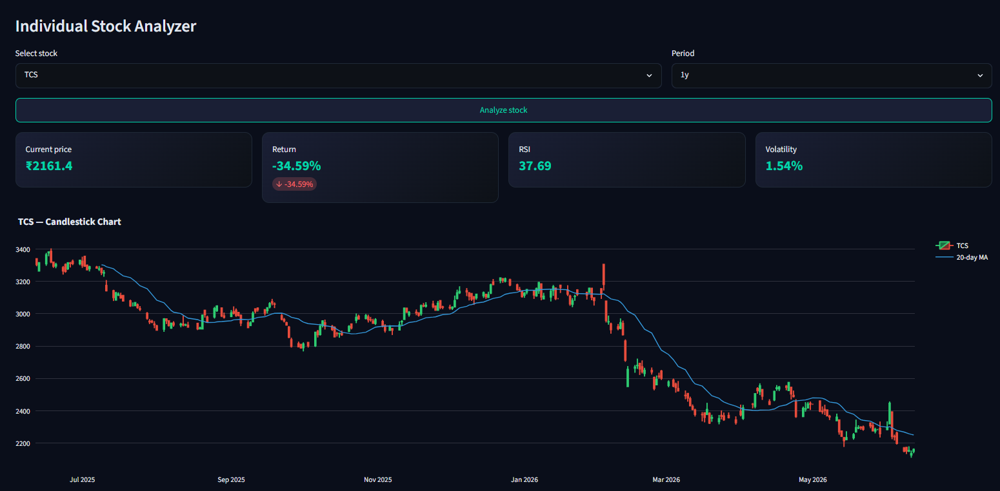
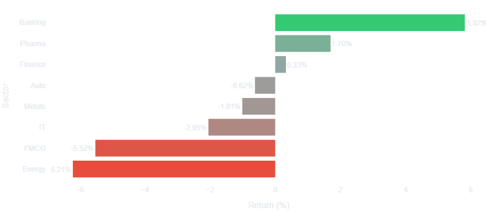

# 🇮🇳 India Stock Market AI Agent

An autonomous AI agent that analyzes live NSE/BSE market data, generates sector insights, performs technical analysis on Nifty 50 stocks, and exports a professional PDF report — all from a single plain English query.


---

## Demo







---

## What It Does

- **AI Agent** — ask any market question in plain English, get institutional-grade analysis
- **Live NSE/BSE data** — real-time Nifty 50 prices via yfinance
- **Sector analysis** — IT, Banking, FMCG, Auto, Pharma, Energy, Metals, Finance
- **Technical indicators** — RSI, 20-day MA, volatility, daily + cumulative returns
- **Candlestick charts** — OHLCV data with moving average overlay
- **PDF report export** — one-click professional market analysis report
- **Buy/Hold/Sell signals** — RSI-based signals for every stock

---

## Key Findings (June 2026)

| Insight | Finding |
|---------|---------|
| Best performing sector | Banking +5.82% (ICICI +8.10%, SBI +6.25%) |
| Worst performing sector | Energy -6.21% |
| Nifty 50 return | +1.04% (1 month) |
| Nifty Bank return | +6.09% |
| Oversold stock | Reliance Industries — RSI 27.11 |
| Market signal | Cautiously bullish — banking led rally |

---

## Tech Stack

| Layer | Technology |
|-------|-----------|
| UI | Streamlit + custom CSS theme |
| AI Agent | Llama 3.3 70B via Groq API |
| Market data | yfinance — live NSE/BSE |
| Technical analysis | Pandas, NumPy |
| Visualization | Plotly (candlestick, bar, line) |
| PDF export | ReportLab |
| Environment | python-dotenv |

---

## Project Structure

stock-market-agent-ai/

├── app.py          # Streamlit dashboard + UI

├── agent.py        # AI agent — fetches data + generates insights

├── analysis.py     # Technical analysis — RSI, returns, volatility

├── report.py       # PDF report generator

├── stocks.py       # Nifty 50 tickers + sector mapping

├── data/           # Generated reports saved here

├── screenshots/    # Dashboard screenshots

├── requirements.txt

└── .env            # API key (not pushed to GitHub)


---

## How to Run Locally

**1. Clone the repo**
```bash
git clone https://github.com/aryzus/stock-market-agent-ai.git
cd stock-market-agent-ai
```

**2. Create virtual environment**
```bash
python -m venv venv
venv\Scripts\activate
```

**3. Install dependencies**
```bash
pip install -r requirements.txt
```

**4. Add your API key**
GROQ_API_KEY=your-groq-key-here


Get a free key at console.groq.com

**5. Run the app**
```bash
python -m streamlit run app.py
```

---

## Dashboard Tabs

### Tab 1 — AI Agent
- Chat interface for plain English market queries
- Autonomous data fetching + analysis
- Buy/Hold/Avoid recommendations with reasoning
- Indian market context — RBI, FII/DII, rupee impact

### Tab 2 — Market Overview
- Live Nifty 50, Sensex, Nifty Bank, Nifty IT indices
- Sector performance horizontal bar chart
- Top 10 stocks table with prices, returns, RSI
- One-click PDF report export

### Tab 3 — Stock Analyzer
- Individual stock candlestick chart with 20-day MA
- Daily returns bar chart
- Cumulative return line chart
- Volume analysis

---

## Skills Demonstrated

- **AI agent development** — autonomous data fetching + LLM reasoning
- **Financial data engineering** — live NSE/BSE pipeline via yfinance
- **Technical analysis** — RSI, moving averages, volatility calculation
- **Data visualization** — candlestick charts, sector heatmaps, return charts
- **PDF generation** — professional report with ReportLab
- **Prompt engineering** — Indian market context injection
- **Full stack** — data pipeline → analysis → AI → UI → export